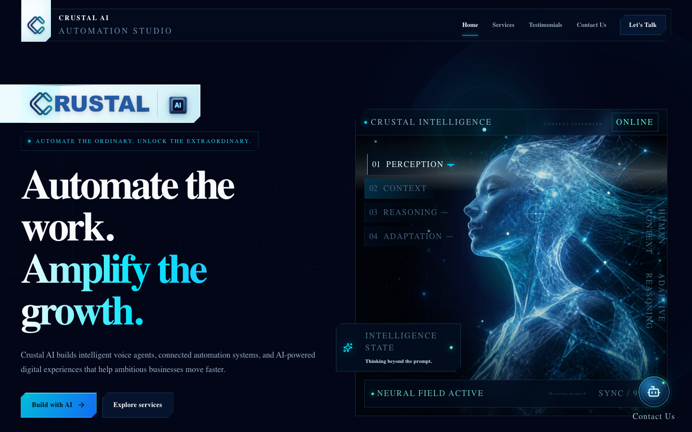
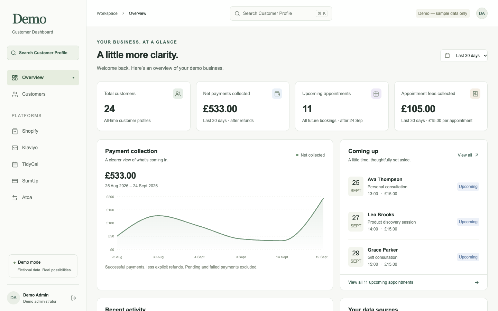
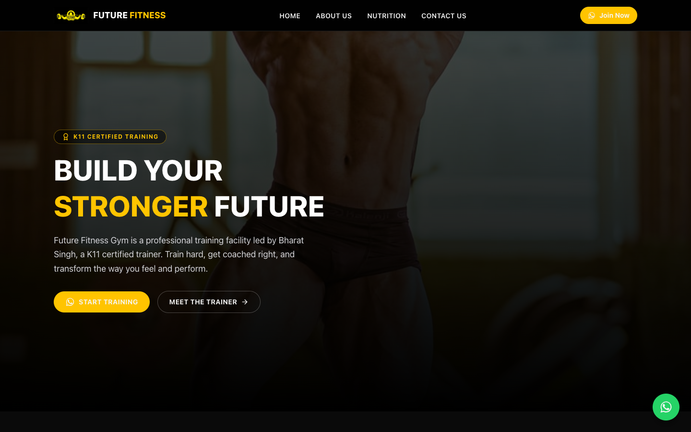

<div align="center">



<a href="https://git.io/typing-svg">
  
</a>

[](https://github.com/adityajaiswal1724)
[](#deployed-systems)
[](#technology-matrix)
[](#ai-ml-agent-systems)
[](#professional-trajectory)

</div>

## `01 / SYSTEM.PROFILE`

```ts
interface Engineer {
  identity: string;
  foundation: string;
  domains: string[];
  operatingPrinciples: string[];
  status: "BUILDING" | "TESTING" | "SHIPPING";
}

const aditya: Engineer = {
  identity: "Aditya Jaiswal",
  foundation: "B.Tech — Computer Science & Engineering",
  domains: [
    "Full-Stack Engineering",
    "AI/ML Engineering",
    "AI Agents & Voice Systems",
    "Workflow Automation",
  ],
  operatingPrinciples: [
    "Make complexity understandable",
    "Test the paths that carry risk",
    "Treat accessibility and security as architecture",
    "Ship work that can explain itself",
  ],
  status: "SHIPPING",
};
```

I am a **Full-Stack Developer and AI/ML & Automation Engineer** building production-minded applications at the intersection of software engineering, machine learning, conversational AI, and business operations. My work spans responsive product interfaces, predictive modelling, Generative AI, LLM-based agents, inbound and outbound voice workflows, API integrations, and end-to-end automation.

Currently an **SDE focused on AI Automation & Agent Development at Crustal Ads**, I design systems that connect language models, speech interfaces, workflow orchestrators, business APIs, CRMs, and communication channels. My repositories are structured as technical case studies with clear architecture, honest scope boundaries, verification steps, and live deployments.

> **Engineering signal:** applied ML · Generative AI · Transformers · voice agents · LLM orchestration · STT/TTS · n8n workflows · full-stack systems

<a id="ai-ml-agent-systems"></a>

## `02 / AI-ML.AGENT.SYSTEMS`

### Applied AI/ML capability map

| Domain | Technical toolkit |
| --- | --- |
| **Machine learning** | Data preprocessing, feature pipelines, predictive modelling, model training/inference, Scikit-learn |
| **Deep learning** | PyTorch, CNNs, LSTMs, Transformer architectures, image captioning |
| **Generative & conversational AI** | LLM integration, prompt design, tool-enabled agents, conversation state, Mistral AI |
| **Voice AI** | Speech-to-text, text-to-speech, Web Speech API, inbound/outbound calling, multilingual/Hinglish flows |
| **Data engineering & analytics** | Python, Pandas, NumPy, SQL, ETL, Power BI, Tableau, KPI and trend analysis |
| **Automation engineering** | n8n, Zapier, Make, Pipedream, event-driven workflows, API/CRM/Google Sheets integration |

### Agent and voice-system architecture

```text
Phone / Web / Messaging channel
              │
              ▼
      STT or structured input
              │
              ▼
  LLM agent + tools + conversation state
              │
      ┌───────┼────────┐
      ▼       ▼        ▼
    APIs     CRM     Knowledge
      │       │        base
      └───────┼────────┘
              ▼
   n8n / workflow orchestration
              │
              ▼
 TTS / response / business action / audit trail
```

### Selected applied AI systems

| System | Engineering contribution | Technology |
| --- | --- | --- |
| **AI Dental Appointment Voice Agent** | Built an inbound agent for appointment booking, rescheduling, and cancellation, with real-time patient-record synchronisation | Vapi, n8n, Google Sheets |
| **Real Estate Outbound AI Calling Agent** | Built a Hinglish conversational agent for lead engagement, follow-up calls, and automated lead workflows | Dograh, n8n |
| **Voice-Enabled Conversational AI Bot** | Engineered a responsive voice interface with real-time speech input/output and an LLM-driven conversational layer | Flask, Python, JavaScript, Mistral AI, Web Speech API |

**AI/ML engineering domains:** supervised learning · predictive modelling · data preprocessing · deep learning · multimodal AI · LLM inference and integration · prompt and conversation design · tool-enabled agents · STT/TTS pipelines · workflow orchestration

> These are CV-backed applied systems; not every implementation is currently available as a public repository.

<a id="deployed-systems"></a>

## `03 / DEPLOYED.SYSTEMS`

<table>
  <tr>
    <td width="50%" valign="top">
      <a href="https://crustalai.vercel.app/"></a>
      <h3 align="center">Crustal AI · Automation Studio</h3>
      <p>A cinematic AI-services platform with reusable service architecture, structured SEO, code-native motion, and a hardened contact pipeline.</p>
      <p align="center"><code>Next.js</code> <code>TypeScript</code> <code>Zod</code> <code>Nodemailer</code></p>
      <p align="center"><a href="https://crustalai.vercel.app/"><b>LIVE SYSTEM ↗</b></a></p>
    </td>
    <td width="50%" valign="top">
      <a href="https://demo-admin-dashboard-dun.vercel.app/"></a>
      <h3 align="center">Unified Customer Operations</h3>
      <p>A typed dashboard that unifies commerce, marketing, scheduling, and payments with ledger-correct metrics and end-to-end tests.</p>
      <p align="center"><code>Next.js</code> <code>Recharts</code> <code>TanStack</code> <code>Playwright</code></p>
      <p align="center"><a href="https://github.com/adityajaiswal1724/demo-admin-dashboard"><b>SOURCE</b></a> · <a href="https://demo-admin-dashboard-dun.vercel.app/"><b>LIVE ↗</b></a></p>
    </td>
  </tr>
  <tr>
    <td width="50%" valign="top">
      <a href="https://jatin-weds-neha.vercel.app/"></a>
      <h3 align="center">Interactive Wedding E-Card</h3>
      <p>A tactile invitation with a canvas scratch interaction, progressive reveal, live countdown, music control, maps, and calendar export.</p>
      <p align="center"><code>React</code> <code>Canvas API</code> <code>Pointer Events</code> <code>iCalendar</code></p>
      <p align="center"><a href="https://github.com/adityajaiswal1724/wedding-e-card"><b>SOURCE</b></a> · <a href="https://jatin-weds-neha.vercel.app/"><b>LIVE ↗</b></a></p>
    </td>
    <td width="50%" valign="top">
      <a href="https://futurefitnessgym-beta.vercel.app/"></a>
      <h3 align="center">Future Fitness Gym</h3>
      <p>A conversion-focused business website with reusable content, responsive pages, local media, and direct WhatsApp journeys.</p>
      <p align="center"><code>Next.js</code> <code>React</code> <code>Tailwind CSS</code> <code>Static Export</code></p>
      <p align="center"><a href="https://github.com/adityajaiswal1724/static-gym-website"><b>SOURCE</b></a> · <a href="https://futurefitnessgym-beta.vercel.app/"><b>LIVE ↗</b></a></p>
    </td>
  </tr>
</table>

<a id="professional-trajectory"></a>

## `04 / PROFESSIONAL.TRAJECTORY`

| Period | Role | Technical focus |
| --- | --- | --- |
| **Jul 2026 - Present** | **SDE - AI Automation & Agent Development**, Crustal Ads Pvt. Ltd. | LLM-based agents, inbound/outbound voice systems, STT/TTS, workflow orchestration, CRM and API integrations |
| **Nov 2025 - May 2026** | **Operations Intern - BGV Operations & AI Automation**, Springworks | Operational workflows, onboarding systems, and automation of repetitive processes |
| **Feb 2025 - May 2025** | **Data Analyst Intern**, Order Health | Python/SQL data pipelines, Power BI KPI dashboards, predictive sales analysis, and n8n customer-support automation |

### Research signal

**Complaint Categorization using Image Captioning and Generative AI** - authored and presented at **ICICC 2025**, with the proceeding published by Springer. The research explored a multimodal image-to-text pipeline using CNN feature extraction, LSTM sequence modelling, Transformer architectures, Flickr8k, and Flickr30k.

### Education

**B.Tech in Computer Science Engineering**, Bennett University - CGPA: **7.8** · 2022-2026

<a id="technology-matrix"></a>

## `05 / TECHNOLOGY.MATRIX`

<div align="center">

### Languages and application runtime


### Full-stack and applied AI


### Automation and delivery


</div>

| Engineering layer | Working knowledge |
| --- | --- |
| **Interface systems** | Responsive composition, semantic HTML, keyboard paths, reduced motion, data visualisation |
| **Application architecture** | Next.js App Router, static exports, reusable components, typed domain models |
| **AI agent systems** | LLM-based architectures, prompt flows, tool use, conversation state, human handoff patterns |
| **Voice AI** | Inbound/outbound call flows, STT, TTS, appointment scheduling, lead qualification, Hinglish conversations |
| **Workflow automation** | n8n, Zapier, Make, Pipedream, event-driven workflows, Google Sheets and CRM integration |
| **Applied AI/ML** | Data preprocessing, feature pipelines, predictive modelling, model training/inference, Scikit-learn, PyTorch |
| **Deep learning & GenAI** | CNNs, LSTMs, Transformers, image captioning, multimodal pipelines, Mistral AI, prompt engineering |
| **Data & analytics** | Python, Pandas, NumPy, SQL, ETL, trend analysis, Power BI, Tableau, Matplotlib, Seaborn |
| **Data experiences** | Deterministic fixtures, filtering, search, reconciliation rules, tables, charts |
| **Backend boundaries** | Server validation, SMTP delivery, origin checks, rate limits, output escaping |
| **Verification** | TypeScript, ESLint, Node tests, Playwright E2E, production build checks |
| **Delivery** | Git workflows, Vercel deployments, environment configuration, technical documentation |

## `06 / ENGINEERING.SIGNALS`

<div align="center">


</div>

## `07 / ENGINEERING.PROTOCOL`

```text
DISCOVER  → understand the user, constraints, and failure modes
MODEL     → define data, states, boundaries, and invariants
ORCHESTRATE → connect models, tools, APIs, state, and business workflows
BUILD     → compose reusable interfaces, services, and agent behaviours
VERIFY    → test critical paths, fallbacks, edge cases, and production output
DOCUMENT  → explain architecture, setup, decisions, and honest limitations
SHIP      → deploy, observe, improve
```

- **Experience is engineering:** visual polish must survive mobile, keyboard, and reduced-motion use.
- **Correctness is visible:** calculations and state transitions should be explainable and testable.
- **Security starts at boundaries:** validate on the server, escape output, constrain requests, protect secrets.
- **Automation needs observability:** log decisions, expose failure states, preserve human control, and design safe handoffs.
- **Documentation is part of the product:** a repository should make its architecture legible in minutes.

## `08 / CURRENT.MISSION`

```yaml
project: developer-portfolio-v2
goal: turn full-stack, AI/ML, and automation work into an engineering story
delivery: Next.js + Vercel
status: designing the system
next:
  - full-stack, AI/ML, and automation experience timeline
  - interactive web, machine-learning, voice-agent, and workflow case studies
  - AI system diagrams with tools, state, fallbacks, and integrations
  - architecture and verification notes
  - performance, accessibility, and SEO budgets
```

<div align="center">

### `BUILD WITH CLARITY // TEST WHAT MATTERS // SHIP WORK WORTH SHOWING`

[](https://github.com/adityajaiswal1724?tab=repositories)
[](#deployed-systems)
[](mailto:adityajaiswal9818@gmail.com)


</div>
